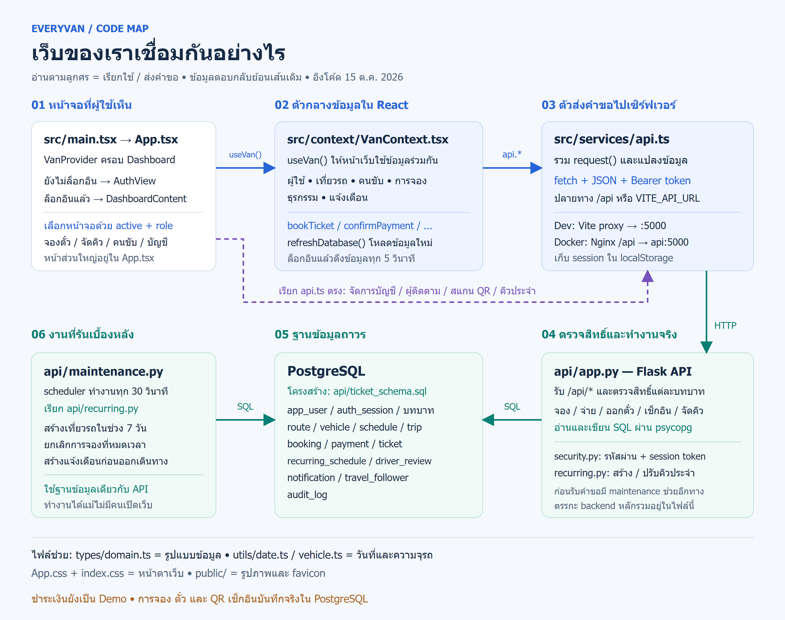
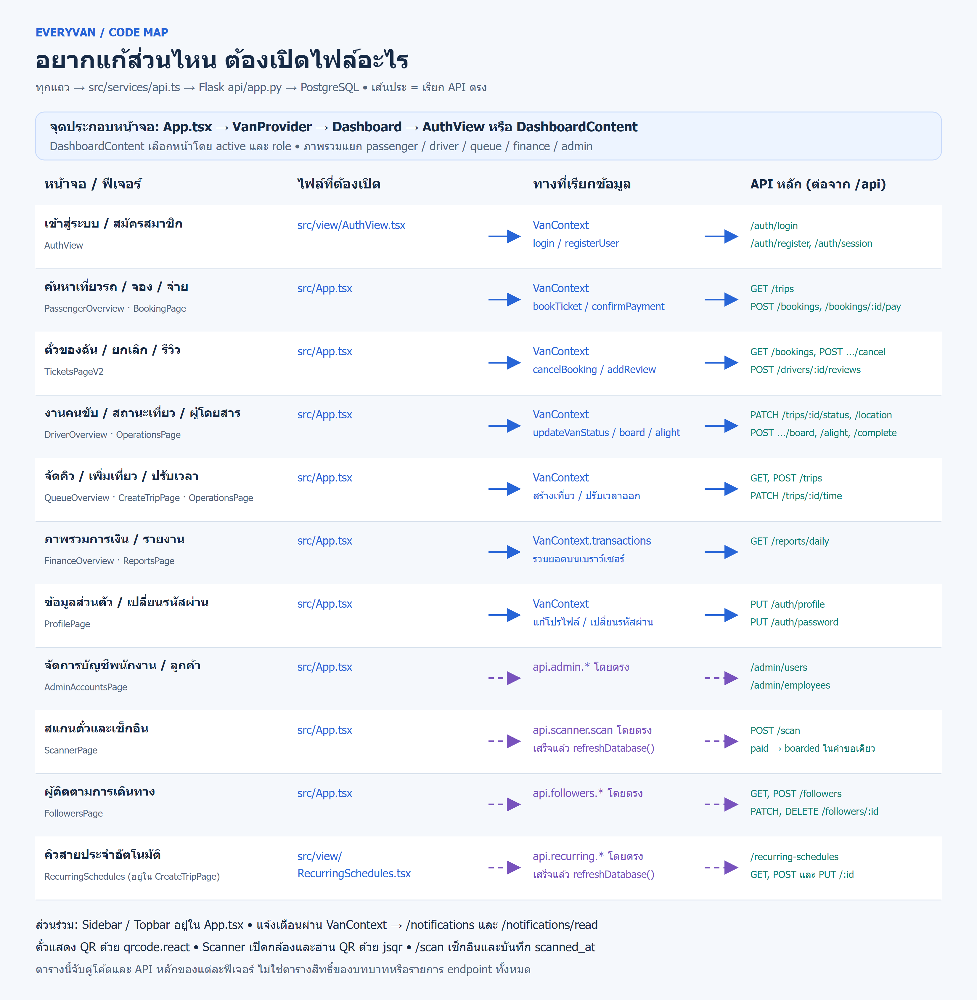

# คู่มืออ่านและอธิบายโค้ด EveryVan

คู่มือนี้สำหรับคนที่เปิดโปรเจกต์แล้วเห็นโค้ดหลายพันบรรทัด แต่ยังไม่รู้จะเริ่มอ่านตรงไหน เป้าหมายคืออ่านให้ตามได้ว่า **ผู้ใช้กดอะไร → ฟังก์ชันไหนทำงาน → ส่งข้อมูลไปไหน → บันทึกอะไร → หน้าจอเปลี่ยนอย่างไร** โดยไม่ต้องจำทุกบรรทัด

เนื้อหาอ้างอิงโค้ดในโปรเจกต์วันที่ **15 ตุลาคม 2026** ชื่อฟังก์ชันและตัวอย่างด้านล่างอิง implementation จริง ส่วนโค้ดที่ระบุว่า “ย่อ” ตัดรายละเอียดออกเพื่อช่วยอธิบาย ไม่ใช่โค้ดสำหรับนำไปแทนทั้งฟังก์ชัน

## สารบัญ

1. [เข้าใจภาพรวมก่อน](#เริ่มต้น)
2. [ลำดับอ่านที่แนะนำ](#ลำดับอ่าน)
3. [หน้าที่ของไฟล์และโฟลเดอร์](#แผนที่ไฟล์)
4. [คำศัพท์และรูปแบบโค้ดที่เจอบ่อย](#คำศัพท์)
5. [จากเปิดเว็บจนเห็นหน้าแรก](#เปิดเว็บ)
6. [ตัวกลางข้อมูลและ API ทำงานอย่างไร](#ข้อมูล)
7. [ตัวอย่างไล่โค้ดตามการใช้งานจริง](#ตัวอย่าง)
8. [อ่านฐานข้อมูลและสถานะให้เข้าใจ](#ฐานข้อมูล)
9. [งานคิวรถอัตโนมัติ](#คิวอัตโนมัติ)
10. [อยากแก้ส่วนไหนเริ่มตรงไหน](#จุดแก้)
11. [วิธีค้นโค้ดและตรวจปัญหา](#ค้นและตรวจ)
12. [แนวทางอธิบายโค้ดให้คนอื่นฟัง](#อธิบาย)

<a id="เริ่มต้น"></a>
## 1 เข้าใจภาพรวมก่อน

EveryVan เป็นระบบจองตั๋วรถตู้ มีเว็บที่ผู้ใช้เห็น ส่วนหลังบ้านที่ตัดสินเงื่อนไขการทำงาน และฐานข้อมูลที่เก็บข้อมูลถาวร

| ส่วน | เทคโนโลยี | หน้าที่ในโปรเจกต์ |
|---|---|---|
| หน้าบ้าน | React และ TypeScript | แสดงฟอร์ม ตาราง ตั๋ว QR และรับการกดของผู้ใช้ |
| เครื่องมือพัฒนาเว็บ | Vite | เปิด dev server และ build ไฟล์เว็บ |
| ส่วนหลังบ้าน | Python และ Flask | รับ API ตรวจผู้ใช้ ตรวจสิทธิ์ ตรวจเงื่อนไข และอ่านเขียนข้อมูล |
| ฐานข้อมูล | PostgreSQL | เก็บบัญชี เที่ยวรถ การจอง การชำระเงิน ตั๋ว และข้อมูลประกอบ |
| งานเบื้องหลัง | Python scheduler | สร้างคิวประจำ จัดการการจองหมดเวลา และสร้างแจ้งเตือน |

เส้นทางที่พบมากที่สุดคือ:

```text
หน้าจอใน App.tsx
  → useVan() / VanContext.tsx
  → services/api.ts
  → /api/... ใน api/app.py
  → PostgreSQL
  → ส่ง JSON กลับมาอัปเดตหน้าจอ
```

บางหน้าเรียก `api.ts` โดยตรง ได้แก่ จัดการบัญชี ผู้ติดตาม สแกนตั๋ว และคิวสายประจำ รายละเอียดอยู่ในหัวข้อ 6



สองไฟล์ที่รวมงานไว้มากคือ `src/App.tsx` และ `api/app.py` ดังนั้นควรอ่านเป็นฟีเจอร์ ไม่จำเป็นต้องอ่านเรียงจากบรรทัดแรกจนถึงบรรทัดสุดท้าย

<a id="ลำดับอ่าน"></a>
## 2 ลำดับอ่านที่แนะนำ

| ลำดับ | เปิดไฟล์หรือค้นชื่อ | อ่านเพื่อให้ตอบคำถามนี้ได้ |
|---|---|---|
| 1 | [src/main.tsx](../../src/main.tsx) | React ถูกติดเข้าหน้า HTML ตรงไหน |
| 2 | [App และ Dashboard](../../src/App.tsx#L2230) | เว็บเลือกหน้าเข้าสู่ระบบหรือหน้าทำงานอย่างไร |
| 3 | [DashboardContent](../../src/App.tsx#L2234) | เมนูเปลี่ยนหน้าและบทบาทเลือกภาพรวมอย่างไร |
| 4 | [types/domain.ts](../../src/types/domain.ts) | Van, Booking, SessionUser และ Transaction มีข้อมูลอะไร |
| 5 | [VanContext.tsx](../../src/context/VanContext.tsx) | ข้อมูลที่หลายหน้าใช้ร่วมกันเก็บตรงไหน |
| 6 | [services/api.ts](../../src/services/api.ts) | ชื่อฟังก์ชันหน้าบ้านตรงกับ API ไหน |
| 7 | เลือกหนึ่งหน้า เช่น [BookingPage](../../src/App.tsx#L534) | ปุ่มแต่ละปุ่มเรียกฟังก์ชันอะไร |
| 8 | [api/app.py](../../api/app.py) | คำขอนั้นผ่านเงื่อนไขอะไรและเขียนตารางไหน |
| 9 | [ticket_schema.sql](../../api/ticket_schema.sql) | ตารางเชื่อมกันด้วยรหัสอะไร |
| 10 | [recurring.py](../../api/recurring.py) และ [maintenance.py](../../api/maintenance.py) | อะไรทำงานได้โดยไม่มีคนเปิดหน้าเว็บ |

รอบแรกอ่านถึงข้อ 6 เพื่อเห็นภาพรวมก่อน รอบที่สองเลือกฟีเจอร์เดียวแล้วตามให้ครบทั้งหน้าบ้านและหลังบ้าน ใช้ [ดัชนีโค้ดและ API](REFERENCE.md) กระโดดไปยังฟังก์ชันที่ต้องการ

<a id="แผนที่ไฟล์"></a>
## 3 หน้าที่ของไฟล์และโฟลเดอร์

```text
EveryVan/
├─ index.html                 จุดที่ React เข้าไปแสดงผล
├─ src/
│  ├─ main.tsx                เริ่ม React และแสดง App
│  ├─ App.tsx                 โครงหน้า เมนู และหน้าจอส่วนใหญ่
│  ├─ App.css                 รูปแบบของคอมโพเนนต์และหน้าจอ
│  ├─ index.css               รูปแบบพื้นฐานร่วมกัน
│  ├─ view/
│  │  ├─ AuthView.tsx         เข้าสู่ระบบและสมัครสมาชิก
│  │  └─ RecurringSchedules.tsx  ฟอร์มและรายการคิวสายประจำ
│  ├─ context/VanContext.tsx  state และ actions ที่หลายหน้าใช้ร่วมกัน
│  ├─ services/api.ts         ตัวส่ง HTTP และแปลงข้อมูลตอบกลับ
│  ├─ types/domain.ts         รูปแบบข้อมูล TypeScript
│  └─ utils/                 ฟังก์ชันวันที่และความจุรถ
├─ api/
│  ├─ app.py                 Flask endpoints และตรรกะธุรกิจหลัก
│  ├─ security.py            hash รหัสผ่านและ session token
│  ├─ recurring.py           ตรวจข้อมูลสายประจำและสร้างเที่ยวรายวัน
│  ├─ maintenance.py         วนทำงานเบื้องหลัง
│  ├─ ticket_schema.sql      โครงสร้างตารางและข้อกำหนดข้อมูล
│  ├─ create_admin.py        สร้างบัญชีผู้ดูแลเริ่มต้น
│  └─ tests/                 ทดสอบหลังบ้าน
├─ public/                   รูปภาพและ favicon
├─ scripts/test-postgres.py  รันทดสอบด้วย PostgreSQL แยกชั่วคราว
├─ package.json              dependencies และคำสั่ง npm
├─ vite.config.ts            React plugin และ proxy ตอนพัฒนา
├─ nginx.conf                เสิร์ฟเว็บและส่ง /api ไป Flask ใน Docker
└─ docker-compose.yml        เปิด web, api, db และ scheduler
```

### หน้าเว็บที่อยู่ใน App.tsx

`BookingPage`, `ScannerPage` และ `ReportsPage` เป็นชื่อฟังก์ชันใน `App.tsx` จึงค้นไฟล์ชื่อ `BookingPage.tsx` ไม่พบ ใช้การค้น `function BookingPage` ภายในไฟล์แทน

| กลุ่ม | ฟังก์ชันสำคัญ | สิ่งที่แสดงหรือจัดการ |
|---|---|---|
| โครงหน้า | `Sidebar`, `Topbar`, `DashboardContent` | เมนู หัวหน้าเว็บ และเลือกเนื้อหา |
| ผู้โดยสาร | `PassengerOverview`, `BookingPage`, `TicketsPageV2` | ดูเที่ยว จอง จ่าย ดูตั๋ว ยกเลิก และรีวิว |
| คนขับ | `DriverOverview`, `ScannerPage`, `OperationsPage` | ภาพรวมเที่ยว สแกนตั๋ว เช็กอินและส่งผู้โดยสาร |
| จัดคิว | `QueueOverview`, `CreateTripPage`, `OperationsPage` | เพิ่มเที่ยว ปรับเวลา จุดล่าสุด สถานะ และเหตุขัดข้อง |
| การเงิน | `FinanceOverview`, `ReportsPage` | ธุรกรรมและยอดรายรับ |
| ผู้ดูแล | `AdminOverview`, `AdminAccountsPage` | ภาพรวมและจัดการบัญชี |
| ส่วนร่วม | `ProfilePage`, `FollowersPage` | ข้อมูลส่วนตัวและผู้ติดตามการเดินทาง |

ตารางนี้จัดกลุ่มตามงานที่ทำ ไม่ใช่รายการสิทธิ์ทั้งหมดของแต่ละบทบาท สิทธิ์จริงต้องอ่าน `@require(...)` และเงื่อนไขใน backend เพิ่มด้วย

<a id="คำศัพท์"></a>
## 4 คำศัพท์และรูปแบบโค้ดที่เจอบ่อย

### Component และ JSX

Component คือฟังก์ชันที่ประกอบส่วนหนึ่งของหน้าจอ ส่วน JSX คือรูปแบบที่หน้าตาคล้าย HTML แต่เขียนอยู่ใน TypeScript ได้ เช่น:

```tsx
function Dashboard() {
  const { currentUser } = useVan();
  return currentUser ? <DashboardContent /> : <AuthView />;
}
```

โค้ดจริงนี้อ่านว่า ดึงผู้ใช้ปัจจุบันจาก Context ถ้ามีผู้ใช้ให้แสดงหน้าทำงาน ถ้าไม่มีให้แสดงหน้าเข้าสู่ระบบ เครื่องหมาย `เงื่อนไข ? A : B` หมายถึงเลือก A หรือ B ตามเงื่อนไข

### Props และ state

Props คือข้อมูลหรือฟังก์ชันที่คอมโพเนนต์แม่ส่งให้ลูก เช่น `BookingPage` รับ `initialVan` เพื่อเริ่มต้นด้วยเที่ยวที่ผู้ใช้เลือก และรับ `onDone` เพื่อให้หน้าแม่เปลี่ยนไปหน้าตั๋ว

State คือค่าที่คอมโพเนนต์จำไว้ระหว่างการใช้งาน ตัวอย่างจริงจาก `BookingPage`:

```tsx
const [seat, setSeat] = useState<number | null>(null);
const [busy, setBusy] = useState(false);
const [error, setError] = useState("");
```

- `seat` เก็บที่นั่งที่เลือก ส่วน `null` คือยังไม่เลือก
- `setSeat(...)` เปลี่ยนค่าและทำให้ React วาดส่วนที่เกี่ยวข้องใหม่
- `busy` ใช้บอกว่ากำลังทำคำขอ ส่วน `error` ใช้แสดงปัญหาบนหน้าจอ
- `<number | null>` กำหนดว่าค่านี้เป็นตัวเลขหรือ null ได้

### useEffect

ใช้ผูกการทำงานกับการเริ่มแสดงคอมโพเนนต์หรือการเปลี่ยนค่าที่ระบุ เช่น `VanContext` ตั้ง interval เมื่อมีผู้ใช้ และคืนฟังก์ชัน `clearInterval` เพื่อหยุด interval เมื่อ effect ถูกยกเลิก

```tsx
useEffect(() => {
  if (!currentUser) return;
  const interval = setInterval(refreshDatabase, 5000);
  return () => clearInterval(interval);
}, [currentUser]);
```

`[currentUser]` คือรายการค่าที่ effect ติดตาม เมื่อค่าเปลี่ยน React จะจัดการ effect รอบเดิมแล้วตั้งรอบใหม่

### async await และ try catch finally

`async` หมายถึงฟังก์ชันคืน Promise ส่วน `await` ใช้รอผลก่อนทำบรรทัดถัดไป โดยไม่บล็อก JavaScript ทั้งหน้าเว็บ ถ้างานล้มเหลวและ throw error จะเข้าส่วน `catch` ขณะที่ `finally` ใช้เก็บงานที่ต้องทำทั้งเมื่อสำเร็จและล้มเหลว เช่น ปิดสถานะ `busy`

### รูปแบบที่เห็นแล้วควรอ่านออก

| รูปแบบ | ความหมายและตัวอย่างในโปรเจกต์ |
|---|---|
| `const { bookings } = useVan()` | หยิบเฉพาะ bookings ออกจาก object ที่ useVan คืนมา |
| `currentUser?.role` | อ่าน role เมื่อ currentUser มีค่า ถ้าไม่มีให้ได้ undefined |
| `value ?? fallback` | ใช้ fallback เมื่อ value เป็น null หรือ undefined |
| `value || fallback` | ใช้ fallback เมื่อ value เป็นค่าที่นับเป็นเท็จ รวมถึง 0 และข้อความว่าง |
| `{ ...form, enabled: false }` | สร้าง object ใหม่จาก form แล้วแทนค่า enabled |
| `array.filter(...)` | เลือกสมาชิกที่ผ่านเงื่อนไข เช่น เลือกการจองของผู้ใช้ |
| `array.map(...)` | แปลงสมาชิกหรือแสดงรายการ JSX |
| `Promise.all([...])` | เริ่มงานหลายรายการแล้วรอให้สำเร็จทั้งหมด |
| `interface Booking` | บอกหน้าตาข้อมูลตอนตรวจ TypeScript ไม่ได้สร้างตารางหรือเช็ก JSON ตอนรันเอง |
| `@app.post(...)` | ผูก Python function เข้ากับ HTTP endpoint |
| `@require("driver")` | ให้ backend ตรวจว่าผู้เรียกล็อกอินและมีบทบาท driver |
| `c.execute(sql, values)` | ส่ง SQL พร้อมค่าพารามิเตอร์ไป PostgreSQL |
| `db().commit()` | ยืนยันการเปลี่ยนข้อมูลใน transaction |

<a id="เปิดเว็บ"></a>
## 5 จากเปิดเว็บจนเห็นหน้าแรก

1. Browser โหลด `index.html` ซึ่งมีจุดติดตั้ง React และโหลด `src/main.tsx`
2. `main.tsx` ใช้ `createRoot(...).render(...)` แสดง `<App />` ภายใน `StrictMode`
3. `App` ครอบ `<Dashboard />` ด้วย `<VanProvider>` ทำให้คอมโพเนนต์ลูกเรียก `useVan()` ได้
4. เมื่อ Provider เริ่มทำงาน จะเรียก `api.auth.getSession()` เพื่อตรวจ session ที่ server
5. ถ้า session ใช้ได้ จะตั้ง `currentUser` และโหลดข้อมูลที่บทบาทนั้นต้องใช้ ถ้าไม่มี session จะโหลดข้อมูลสาธารณะอย่างเที่ยวรถกับคนขับ
6. `Dashboard` อ่าน `currentUser` แล้วเลือก `AuthView` หรือ `DashboardContent`

ระหว่างกำลังตรวจ session ค่าเริ่มต้นของ `currentUser` ยังเป็น null จึงอาจเห็นหน้าเข้าสู่ระบบก่อนข้อมูล session กลับมา อ่านโค้ดนี้โดยแยก “ยังไม่มีค่าใน state” ออกจาก “server ตัดสินว่า session ใช้ไม่ได้”

### เมนูเปลี่ยนหน้าอย่างไร

ใน `DashboardContent` มี:

```tsx
const [active, setActive] = useState<NavKey>("overview");
```

เมื่อกดเมนู `Sidebar` จะเรียก callback ไปยังหน้าแม่ แล้วเปลี่ยน `active` เช่น `"book"`, `"tickets"` หรือ `"operations"` จากนั้นตัวแปร `content` เลือกคอมโพเนนต์ที่จะแสดง

โปรเจกต์นี้ไม่ได้ใช้ React Router ในการเลือกหน้าพวกนี้ ดังนั้นเมื่อจะเพิ่มเมนู ต้องดู `NavKey`, รายการเมนูใน `Sidebar`, ชื่อหัวหน้าเว็บ และเงื่อนไขเลือก `content` ร่วมกัน ส่วน `role` ใช้เลือกภาพรวมที่เหมาะกับผู้โดยสาร คนขับ ฝ่ายบัญชี ผู้จัดคิว หรือผู้ดูแล

<a id="ข้อมูล"></a>
## 6 ตัวกลางข้อมูลและ API ทำงานอย่างไร

### VanContext คือข้อมูลร่วมในหน่วยความจำของหน้าเว็บ

`VanProvider` เก็บ `currentUser`, `drivers`, `vans`, `bookings`, `transactions` และ `notifications` ไว้ใน React state พร้อมเปิด actions เช่น `bookTicket`, `confirmPayment`, `updateVanStatus` และ `refreshDatabase`

`useVan()` เป็น hook ที่ให้คอมโพเนนต์ลูกเข้าถึงค่าพวกนี้ หากเรียกนอก Provider จะ throw error เพื่อบอกว่าโครงคอมโพเนนต์วางไม่ถูก

แม้ฟังก์ชันจะชื่อ `refreshDatabase` แต่หน้าที่ของมันคือ **เรียก API แล้วโหลดข้อมูลมาใส่ React state ใหม่** ไม่ได้ล้างฐานข้อมูลหรือสร้าง schema ใหม่ ฟังก์ชันนี้ใช้ `Promise.all` โหลดข้อมูลหลายชุด และโหลดธุรกรรมเฉพาะบทบาท `accountant`, `staff`, `dispatcher`, `admin`

เมื่อทำ action สำเร็จ หลายฟังก์ชันจะเรียก refresh ทันที และหลังล็อกอินจะมี polling ทุก 5 วินาทีอีกทางหนึ่ง จึงเห็นข้อมูลจากผู้ใช้คนอื่นเปลี่ยนตามหลังช่วงสั้น ๆ โดยไม่มี WebSocket ในเส้นทางนี้

### api.ts คือประตูออกจาก browser

ให้เริ่มอ่านที่ `BASE` และ `request<T>()`:

1. `BASE` ใช้ `VITE_API_URL` ถ้าตั้งไว้ หรือใช้ `/api`
2. อ่าน session ที่เก็บใน localStorage
3. เตรียม `Content-Type: application/json` และ `Authorization: Bearer ...` หากมี token
4. เรียก `fetch` ไปยัง endpoint
5. อ่าน JSON ถ้า HTTP ไม่สำเร็จจะ throw error จากข้อความที่ server ส่งมา
6. คืนข้อมูลให้ฟังก์ชันในกลุ่ม `api.auth`, `api.vans`, `api.bookings` และกลุ่มอื่นนำไปใช้ต่อ

ตัวอย่าง: `api.vans.list()` เรียก `GET /trips` ผ่าน `request` เมื่อ BASE เป็น `/api` URL จริงจึงเป็น `/api/trips`

`apiStatus` เก็บสถานะ `checking`, `online`, `offline` เพื่อให้ UI แสดงแถบเชื่อมต่อไม่สำเร็จได้ คำขอที่ส่งถึง server แล้วได้ 400 หรือ 403 ยังนับว่าเชื่อมต่อได้ ส่วน fetch ล้มเหลวหรือ HTTP 503 จะตั้งสถานะ offline

### ชื่อข้อมูลของแต่ละชั้นอาจไม่เหมือนกัน

ดู `mapBooking`, `mapDriver` และ `mapVan` ใน `api.ts` ก่อนสรุปว่าชื่อ field หายไป:

| ข้อมูลจาก backend | ข้อมูลที่หน้าบ้านใช้ |
|---|---|
| `booking_id` | `Booking.id` เป็น string |
| `trip_id` | `Booking.vanId` |
| `seat_number` | `Booking.seatNo` เป็น number |
| `booking_status: "paid"` | `Booking.status: "Paid"` |
| `qr_code` | `Booking.qrCode` |
| `receipt_no` | `Booking.receiptNo` |

ชื่อ `Van` ใน frontend ใช้แทนข้อมูล **เที่ยวรถที่แสดงบนเว็บ** ซึ่งรวมรถ คนขับ เส้นทาง เวลา และที่นั่งจากหลายตาราง ไม่ได้ตรงกับตาราง `vehicle` เพียงตารางเดียว โดย `Van.id` ใช้เป็น `trip_id` เมื่อจอง

### หน้าไหนเรียก API โดยตรง

| หน้าจอ | เรียกโดยตรง | ใช้ Context ร่วมด้วย |
|---|---|---|
| `AdminAccountsPage` | `api.admin.*` | มี state และโหลดบัญชีเอง ไม่ได้เรียก useVan ในหน้านี้ |
| `FollowersPage` | `api.followers.*` | ใช้ข้อมูลผู้ใช้ปัจจุบัน |
| `ScannerPage` | `api.scanner.scan` | เรียก refreshDatabase หลังสแกน |
| `RecurringSchedules` | `api.recurring.*` | อ่านรายชื่อคนขับและ refresh หลังบันทึก |

หน้าเหล่านี้มี state หรือฟังก์ชันโหลดของตัวเอง จึงไม่ควรสมมติว่ารายการทุกหน้าถูก polling พร้อมกันโดย Context

<a id="ตัวอย่าง"></a>
## 7 ตัวอย่างไล่โค้ดตามการใช้งานจริง

### ตัวอย่างแรก เข้าสู่ระบบ

```text
AuthView.submit
  → VanContext.login
  → api.auth.login
  → POST /api/auth/login
  → app.py: login → security.py: check_password
  → auth_session + ข้อมูลผู้ใช้
  → บันทึก session ฝั่ง browser และตั้ง pendingOtpUser
  → AuthView.submitOtp → VanContext.verifyOtp รับตัวเลขครบ 6 หลัก
  → ตั้ง currentUser และโหลดข้อมูลตามบทบาท
  → Dashboard เปลี่ยนมาแสดง DashboardContent
```

`AuthView.submit` อ่านค่าฟอร์ม ตั้ง `busy` และเลือกว่าจะ login หรือ register เมื่อ login สำเร็จ `api.ts` เก็บ token พร้อมผู้ใช้ใน localStorage แล้ว Context รอที่ `pendingOtpUser` จนกว่าจะกรอก OTP ครบ 6 หลัก จึงตั้ง `currentUser` และโหลดข้อมูลตามบทบาท ขั้น OTP เป็นแบบจำลอง รับตัวเลข 0-9 ใดก็ได้ครบ 6 หลัก ไม่มีการส่ง SMS หรือแสดงข้อความ Demo บนหน้าเว็บ รีเฟรชระหว่างรอ OTP ยังต้องยืนยันต่อ

Backend ตรวจบัญชีและรหัสผ่านด้วย `check_password` พร้อมตรวจ `is_active` เมื่อผ่านจะสร้าง token แบบสุ่ม เก็บ **hash ของ token** ใน `auth_session` แล้วส่ง token ตัวจริงกลับ browser คำขอถัดไปแนบ token ใน header

`uid()` ตรวจ hash, วันหมดอายุ และบัญชียังเปิดใช้งานอยู่ ส่วน `@require(...)` ตรวจบทบาทเพิ่ม session มีอายุเริ่มต้น 12 ชั่วโมงตาม schema ไม่ได้ใช้ JWT ใน flow นี้ และการสมัครจากหน้าสาธารณะเป็นบัญชี passenger

### ตัวอย่างที่สอง กดจองที่นั่ง

เปิด `BookingPage` แล้วหา `createBooking` โค้ดย่อจากส่วนสำคัญคือ:

```tsx
const b = await bookTicket(selectedVan.id, seat, point, dropOffPoint, date);
setBooking(b);
setStep(4);
```

บรรทัดแรกขอให้ระบบสร้างการจอง เมื่อสำเร็จจึงเก็บ booking ที่ได้และเปลี่ยนไปขั้นชำระเงิน การตั้ง `step` เป็นเพียงเปลี่ยนส่วนที่แสดงในหน้าเดียว ไม่ได้สร้างการจองเพิ่มอีกครั้ง

เส้นทางเต็ม:

```text
BookingPage.createBooking
  → VanContext.bookTicket
  → api.bookings.create
  → POST /api/bookings
  → app.py: create_booking
  → INSERT booking + INSERT payment + audit_log
  → refreshDatabase
  → หน้าแสดงขั้นชำระเงิน
```

Backend ตรวจข้อมูลเที่ยวและที่นั่ง จุดขึ้นลง ผู้โดยสาร สถานะเที่ยว เวลาออก และที่นั่งซ้ำ ภายใน transaction มีการล็อกข้อมูลและมี unique index ช่วยกันการจองชนกัน หากที่นั่งถูกจองไปก่อน API จะตอบ 409

เมื่อสร้างสำเร็จ `booking` เริ่มเป็น `pending`, `payment` เริ่มเป็น `unpaid` และมีเวลาหมดอายุเริ่มต้น 5 นาทีตาม schema ยังไม่มีตั๋วในตาราง `ticket`

จุดที่ควรอ่านให้ละเอียด: frontend ส่ง `amount: 220` ใน payload ของการสร้าง booking แต่ backend ใช้ `trip.fare` ที่อ่านจากฐานข้อมูลตอนสร้าง payment ดังนั้นการตาม “ราคาที่บันทึกจริง” ต้องไปถึง SQL ใน backend

### ตัวอย่างที่สาม ชำระเงินและแสดงตั๋ว

```text
BookingPage.pay
  → VanContext.confirmPayment
  → api.bookings.pay
  → POST /api/bookings/:id/pay
  → app.py: pay
  → booking = paid / payment = success / สร้าง ticket และ receipt_no
  → refreshDatabase → GET /api/bookings
  → TicketsPageV2 แสดงข้อมูลและ QR
```

Backend ตรวจว่าผู้เรียกเข้าถึง booking นี้ได้ และรายการยังเป็น pending ที่ไม่หมดอายุ จึงเปลี่ยนสถานะ สร้างรหัสใบเสร็จ และสุ่ม `qr_code` ของตั๋ว

การจ่ายปัจจุบันยังเป็น **Demo** endpoint เปลี่ยนสถานะสำเร็จและสร้างตั๋วโดยตรง ไม่มีการยืนยันรายการผ่านธนาคารหรือ external Payment Gateway

`TicketsPageV2` อ่าน `bookings` จาก Context ซึ่งมาจาก `GET /api/bookings` ที่ JOIN ตารางตั๋วและ payment มาด้วย ไม่ได้เรียก `/api/tickets` แยกทุกครั้งที่เปิดหน้านี้ ส่วน `QRCodeSVG` จาก `qrcode.react` วาดภาพ QR จากค่าที่ได้

### ตัวอย่างที่สี่ คนขับสแกน QR

```text
ScannerPage เปิดกล้อง
  → jsqr อ่านภาพและได้รหัส
  → ScannerPage.check
  → api.scanner.scan
  → POST /api/scan
  → app.py: scan
  → ตรวจสิทธิ์ / ตั๋ว / การชำระ / วันเดินทาง / สถานะเที่ยว
  → booking = boarded และ ticket.scanned_at = NOW()
  → refreshDatabase และแสดงผล
```

มีช่องกรอกรหัสเป็นอีกทางเข้า แล้วมารวมที่ `check` เช่นเดียวกัน backend ใช้ `@require("driver")` และตรวจว่าเที่ยวอยู่ในความรับผิดชอบของคนขับ

การสแกนปัจจุบัน **เช็กอินในคำขอเดียว** ถ้าเป็นการสแกนซ้ำหลังขึ้นรถแล้วจะส่ง `already_checked_in` กลับมา โดยไม่เขียนเวลาเช็กอินซ้ำ ส่วนการเช็กอินผ่านรายการผู้โดยสารมี `/api/bookings/:id/board` เป็นอีกเส้นทางหนึ่ง

หากอ่าน `mapBooking` แล้วเห็น `checkedInAt` ให้ตรวจ SELECT ของ endpoint ด้วย ขณะนี้ `GET /api/bookings` ไม่ได้เลือก `scanned_at` มาในผลลัพธ์ แม้ endpoint สแกนจะบันทึกและส่งค่านี้กลับแล้วก็ตาม

### ตัวอย่างที่ห้า รายงานการเงิน

`VanContext.refreshDatabase` เรียก `api.transactions.list()` สำหรับบทบาทที่เกี่ยวข้อง ฟังก์ชันนี้ใช้ `GET /api/reports/daily` แล้วนำ `transactions` มาแปลงเป็น type ของหน้าบ้าน

Backend ส่งทั้ง `summary` ของรายการสำเร็จวันนี้ตามเวลาไทยและรายการธุรกรรม แต่ `ReportsPage` ใช้ `transactions` ใน Context กรอง `status === "Success"` แล้วคำนวณยอดรวมกับยอดวันนี้ใน browser ดังนั้นการแก้สูตรที่หน้า report ต้องตรวจทั้งวิธีกรองหน้าบ้านและข้อมูลที่ API ส่งมา

### ตัวอย่างที่หก แก้เวลาเที่ยวรถ

`OperationsPage` เรียก action ใน Context แล้วไป `api.vans.updateDepartureTime` หรือ `updateArrivalTime` ซึ่งใช้ `PATCH /api/trips/:id/time`

Backend ตั้ง `trip.schedule_override = TRUE` และแก้เวลาในตาราง `schedule` พร้อมสร้าง audit และแจ้งเตือน ค่านี้มีผลต่อ scheduler เพราะบอกว่าเที่ยวนี้ถูกปรับเฉพาะวันแล้ว ต้องไม่ใช้การแก้แม่แบบคิวประจำมาเขียนทับ

<a id="ฐานข้อมูล"></a>
## 8 อ่านฐานข้อมูลและสถานะให้เข้าใจ

### ตารางหลักเชื่อมกันอย่างไร

```text
app_user ── passenger ── booking ── payment
    │                       └────── ticket
    ├───── driver ──┐
    └───── staff    │
                    ▼
route ──────────── trip ─────────── booking
vehicle ───────────┤
schedule ──────────┘
recurring_schedule ── trip ของแต่ละ service_date
```

ภาพนี้สรุปความเกี่ยวข้องเพื่ออ่าน flow ไม่ใช่ ER diagram ที่แสดง cardinality และ foreign key ครบทุกตัว

| ตาราง | ควรเข้าใจว่าเก็บอะไร |
|---|---|
| `app_user` | บัญชี ชื่อ บทบาท รหัสผ่านที่ hash แล้ว และสถานะเปิดใช้งาน |
| `auth_session` | hash ของ token ผู้ใช้ และเวลาหมดอายุ |
| `passenger`, `driver`, `staff` | ข้อมูลประกอบของบัญชีตามบทบาท |
| `route` | ต้นทางและปลายทางของเส้นทาง |
| `vehicle`, `seat` | รถ ความจุ และรายละเอียดที่นั่งของรถ |
| `schedule` | เวลาออก เวลาถึง และเปิดใช้ตารางเวลาหรือไม่ |
| `trip` | เที่ยวเดินทางที่ผูกเส้นทาง รถ คนขับ เวลา ค่าโดยสาร และจุดลง |
| `booking` | ผู้โดยสารจองที่นั่งใดของเที่ยวไหน พร้อมสถานะและเวลาหมดอายุ |
| `payment` | สถานะชำระ ยอดเงิน และใบเสร็จของ booking |
| `ticket` | รหัส QR สถานะตั๋ว และเวลาเช็กอิน |
| `recurring_schedule` | แม่แบบสายประจำที่นำไปสร้างเที่ยวรายวัน |
| `travel_follower` | ใครขอติดตามใครและตอบรับแล้วหรือยัง |
| `notification`, `audit_log`, `driver_review` | แจ้งเตือน ประวัติการกระทำ และรีวิวคนขับ |

การตรวจว่าที่นั่งเที่ยวหนึ่งว่างหรือไม่ต้องดู active bookings ของ `trip_id` นั้นด้วย อย่าตีความว่า `seat.seat_status` เพียงค่าเดียวบอกสถานะที่นั่งได้ทุกวันทุกเที่ยว

### ชื่อสถานะการจองของ backend และ frontend

| ฐานข้อมูล | หน้าบ้าน | ความหมาย |
|---|---|---|
| `pending` | `Pending Payment` | จองแล้วแต่ยังไม่จ่าย |
| `paid` | `Paid` | จ่ายแล้ว |
| `boarded` | `Boarded` | เช็กอินขึ้นรถแล้ว |
| `alighted` | `Alighted` | ยืนยันลงรถและปล่อยที่นั่ง |
| `completed` | `Completed` | การจองถูกปิดตามการจบทริป |
| `cancelled` | `Cancelled` | ยกเลิกหรือหมดเวลาจ่าย |

การเปลี่ยนสถานะที่พบในโค้ด:

```text
pending → paid                    จ่ายภายในเวลาที่กำหนด
pending → cancelled               หมดเวลาหรือยกเลิก
paid → cancelled                  ยกเลิกในเงื่อนไขที่ endpoint อนุญาต
paid → boarded                    สแกน QR หรือเช็กอินจากรายการ
boarded → alighted                ลงรายคน / ลงตามจุด / ถึงเวลาปล่อยที่นั่ง
paid หรือ boarded → completed     complete_trip ปิดเที่ยวรถ
```

รายการที่ alighted แล้วไม่จำเป็นต้องเปลี่ยนเป็น completed ภายหลัง เพราะ `complete_trip` อัปเดตเฉพาะ paid และ boarded

สถานะ payment เป็นอีกชุดคือ `unpaid`, `success`, `cancelled` ส่วนสถานะ trip เป็น `waiting`, `travelling`, `departed`, `accident`, `completed` ทั้งสามชุดมีความหมายคนละเรื่อง และ `ticket_status` เป็น field แยกอีกตัว จึงต้องอ่านว่าแต่ละ endpoint อัปเดตตารางใดบ้าง

Unique index `uq_active_trip_seat` ห้ามมี booking ที่ยังครองที่นั่งซ้ำใน `(trip_id, seat_number)` เดียวกัน โดยยกเว้น booking ที่ cancelled, completed หรือ alighted ส่วน `uq_recurring_service_date` ป้องกันการสร้างเที่ยวรายวันซ้ำของแม่แบบเดียวกัน

<a id="คิวอัตโนมัติ"></a>
## 9 งานคิวรถอัตโนมัติ

อ่านส่วนนี้เป็นสองฝั่งที่ใช้ข้อมูลแม่แบบเดียวกัน:

```text
CreateTripPage → RecurringSchedules
  → api.recurring.save → /api/recurring-schedules
  → ตรวจข้อมูลและบันทึก recurring_schedule
  → generate_daily_trips

maintenance.py ทุก 30 วินาที
  → initialize_schema
  → generate_daily_trips
  → cleanup_expired
  → create_departure_notifications
```

`RecurringSchedules` ใช้ Context เพื่ออ่านคนขับ แต่รายการสายประจำและการบันทึกเรียก `api.recurring` โดยตรง เมื่อสำเร็จจะโหลดรายการตัวเองใหม่และ refresh ข้อมูลร่วม

`generate_daily_trips` ใช้เวลา Asia/Bangkok สร้างเที่ยวในช่วง 7 วันนับจากวันนี้ ข้ามวันก่อนเริ่มสายและเวลาออกที่ผ่านไปแล้ว ก่อนสร้างตรวจว่า `(recurring_id, service_date)` นั้นมีเที่ยวแล้วหรือไม่ และใช้ database lock ร่วมกับ API เพื่อไม่ให้หลาย process สร้างชนกัน

การแก้แม่แบบจะปรับเที่ยวที่ยังเป็น waiting เวลาออกยังอยู่ในอนาคต ไม่มี booking ที่ยังครองที่นั่ง และไม่ได้ถูก override เฉพาะวัน เที่ยวที่มีผู้จองหรือมี override จะถูกคงไว้ การพักและเปิดสายประจำใช้เงื่อนไขปกป้องเที่ยวเช่นกัน และการเปิดกลับอาจเปิดใช้ occurrence เดิมแทนสร้างใหม่

`app.py` มี maintenance ใน `before_request` เป็นทางสำรองด้วย โดยเว้นช่วงภายใน process แต่ละตัว ส่วน scheduler เป็น process แยกที่ยังต้องเปิดไว้เพื่อให้ทำงานต่อเนื่องแม้ไม่มีคำขอจากหน้าเว็บ

`cleanup_expired` ไม่ได้ทำแค่หมดเวลาจ่าย ยังปล่อย booking ที่ boarded ให้เป็น alighted เมื่อถึง `schedule.arrive_time` ที่กำหนดไว้ ส่วนแจ้งเตือนก่อนออกเดินทางดูช่วง 15 นาทีข้างหน้าและมีเงื่อนไขกันแจ้งซ้ำ

<a id="จุดแก้"></a>
## 10 อยากแก้ส่วนไหนเริ่มตรงไหน

| งานที่ต้องการ | เริ่มอ่าน | อ่านต่อก่อนแก้เสร็จ |
|---|---|---|
| ปรับสี ระยะห่าง รูปแบบบัตร | `App.css`, `index.css` และ className ในหน้าเป้าหมาย | หน้าจอบนขนาดจอที่เกี่ยวข้อง |
| เปลี่ยนช่องสมัครสมาชิก | `AuthView` | `registerUser` → `api.auth.register` → `app.py: register` → schema |
| เพิ่มหน้าและเมนู | `NavKey`, `Sidebar`, `DashboardContent` ใน App.tsx | role ที่เห็นเมนูและสิทธิ์ backend |
| แก้การค้นหาเที่ยว | `BookingPage.availableVans` | ข้อมูลจาก `api.vans.list` และ `app.py: trips` |
| แก้เงื่อนไขการจอง | `BookingPage.createBooking` | `bookTicket` → `api.bookings.create` → `create_booking` → unique index |
| แก้ราคาเที่ยว | `CreateTripPage` หรือ `RecurringSchedules` | API สร้างเที่ยว/แม่แบบ, `trip.fare`, SQL สร้าง payment |
| แก้ความจุรถ | `utils/vehicle.ts` | validation ใน `app.py`, `recurring.py` และ vehicle/seat |
| แก้รูปแบบตั๋ว | `TicketsPageV2` | `mapBooking`, SELECT ของ bookings และ QR payload |
| แก้การสแกน | `ScannerPage.check` และส่วนกล้อง | `api.scanner.scan` → `app.py: scan` |
| เพิ่มสิทธิ์ให้ทำรายการ | เมนูและเงื่อนไข UI | `@require` และ `can_access_*` / `can_manage_trip` |
| แก้ข้อมูลรายงาน | `FinanceOverview`, `ReportsPage` | `api.transactions.list` → `app.py: report` |
| แก้สายประจำ | `RecurringSchedules` | `save_recurring_schedule`, `normalize_template`, `generate_daily_trips` |
| แก้วันที่หรือวันเดินทางผิด | `utils/date.ts`, helper ใน api.ts | timezone ใน app.py / recurring.py และชนิด TIMESTAMPTZ |

การซ่อนเมนูใน frontend เปลี่ยนสิ่งที่ผู้ใช้เห็น แต่สิทธิ์การทำรายการจริงอยู่ที่ backend การเพิ่มปุ่มให้บทบาทใดจึงต้องตรวจว่าคำขอนั้นผ่านทั้งสองชั้น



<a id="ค้นและตรวจ"></a>
## 11 วิธีค้นโค้ดและตรวจปัญหา

คำสั่งด้านล่างรันจากโฟลเดอร์ EveryVan ใช้ `rg` ถ้ามีติดตั้ง หรือค้นข้อความเดียวกันผ่าน editor ได้

```powershell
rg -n 'function BookingPage|const createBooking' src/App.tsx
rg -n 'bookTicket|confirmPayment' src/context/VanContext.tsx
rg -n 'bookings:|/bookings|mapBooking' src/services/api.ts
rg -n 'def create_booking|def pay|def scan' api/app.py
rg -n 'CREATE TABLE|CREATE UNIQUE INDEX' api/ticket_schema.sql
```

### วิธีตามปุ่มหนึ่งปุ่ม

1. ค้นข้อความที่เห็นบนปุ่มหรือชื่อหน้าใน JSX
2. ดู `onClick` หรือ `onSubmit` ว่าเรียกฟังก์ชันไหน
3. อ่าน state ที่ handler ใช้และค่าใหม่ที่ตั้งหลังสำเร็จ
4. ถ้าเรียก `useVan` ตามไป action ใน Context ถ้าเรียก `api.*` ตามไป api.ts
5. จด HTTP method กับ path แล้วค้น decorator ใน app.py
6. อ่าน `@require`, validation, SQL และจุด commit
7. ตาม response กลับมาที่ mapper, state และ JSX ที่แสดงผล

### ตรวจจาก Network ให้รู้ว่าปัญหาอยู่ชั้นไหน

เปิด Developer Tools ของ browser ไปที่ Network แล้วทำรายการหนึ่งครั้ง ตรวจ URL, method, payload, HTTP status และ JSON response จากนั้นเทียบกับฟังก์ชันที่อ่าน

| อาการ | จุดที่ควรตรวจ |
|---|---|
| กดแล้วไม่มีคำขอออกไป | เงื่อนไข disabled, validation, handler และ Console |
| HTTP 400 | ข้อมูลฟอร์มหรือเงื่อนไขสถานะตามข้อความ error |
| HTTP 401 | session/token ไม่มี ใช้ไม่ได้ หรือหมดอายุ |
| HTTP 403 | บทบาท สิทธิ์เจ้าของข้อมูล หรือสิทธิ์คนขับต่อเที่ยว |
| HTTP 404 | endpoint หรือรายการเป้าหมายไม่พบ |
| HTTP 409 | สถานะขัดกันหรือที่นั่งถูกจองไปแล้ว |
| HTTP 503 หรือ fetch ล้มเหลว | API ฐานข้อมูล proxy และค่าการเชื่อมต่อ |
| API ตอบสำเร็จแต่ UI ไม่เปลี่ยน | response mapper, refresh, state เฉพาะหน้า และเงื่อนไข JSX |
| เที่ยวสายประจำไม่เพิ่ม | scheduler, enabled, start_date, เวลาไทย และเที่ยวเดิม |

`refreshDatabase` จับ error หลักแล้วเขียน Console โดยไม่ได้ throw ต่อทุกกรณี ส่วนการโหลด notifications มี `.catch(() => [])` แยก จึงควรตรวจ Network ประกอบการดูข้อความบนหน้าเว็บ

### คำสั่งรันและตรวจที่มีอยู่แล้ว

| คำสั่ง | ทำอะไร |
|---|---|
| `npm start` | เปิด Flask API, Vite และ scheduler พร้อมกัน ไม่ได้เปิด PostgreSQL ให้เอง |
| `npm run dev` | เปิดเฉพาะเว็บตอนพัฒนา |
| `npm run api` | เปิด Flask API |
| `npm run scheduler` | เปิดงานเบื้องหลัง |
| `npm run check` | lint, frontend tests, build และ Python unittest |
| `npm run test:smoke` | ใช้ scripts/test-postgres.py เปิด PostgreSQL แยกชั่วคราวแล้วทดสอบ |

การเตรียม dependencies, `.env`, PostgreSQL และ Docker อ่าน [README หลัก](../../README.md) ต่อได้ ส่วน runtime integration tests จะถูกข้ามเมื่อไม่ได้ตั้งฐานทดสอบที่กำหนดไว้ ดังนั้น `npm run check` ผ่านอย่างเดียวไม่ได้หมายความว่าได้รัน integration tests กับฐานข้อมูลครบแล้ว

เริ่มอ่าน tests ที่เกี่ยวข้องเพื่อเห็นเงื่อนไขคาดหวัง: `api.test.ts` เรื่องการเชื่อมต่อและไม่มีข้อมูลจำลอง, `date.test.ts` เรื่องเวลาไทย, `test_security.py` เรื่องรหัสผ่าน/session, `test_schema_contract.py` เรื่องข้อกำหนดตาราง และ `test_runtime_integration.py` เรื่องสแกน คิวประจำ และการทำงานพร้อมกัน

<a id="อธิบาย"></a>
## 12 แนวทางอธิบายโค้ดให้คนอื่นฟัง

อธิบายทีละฟีเจอร์ด้วยห้าประเด็น: ผู้ใช้ทำอะไร หน้าจอเก็บค่าอะไร ฟังก์ชันไหนส่งคำขอ backend ตรวจและบันทึกอะไร แล้วผลกลับมาแสดงที่ไหน

ตัวอย่างอธิบายการจอง:

> ผู้โดยสารเลือกเที่ยว จุดขึ้น จุดลง และที่นั่งใน BookingPage แล้วกดยืนยัน หน้าเว็บเรียก bookTicket ผ่าน VanContext ไปยัง api.bookings.create ซึ่งส่ง POST /api/bookings ฝั่ง Flask ตรวจผู้โดยสาร เที่ยวรถ จุดขึ้นลง และที่นั่ง ก่อนสร้าง booking กับ payment ใน transaction เดียว เมื่อสำเร็จ Context โหลดข้อมูลใหม่และหน้าเว็บแสดงขั้นชำระเงิน ตอนนี้ยังไม่ออกตั๋วจนกว่าจะจ่ายสำเร็จ

ตัวอย่างอธิบาย Context:

> VanContext เป็นที่เก็บข้อมูลร่วมของหน้าเว็บ เช่น ผู้ใช้ เที่ยวรถ และการจอง หน้าอื่นเรียก useVan เพื่ออ่านข้อมูลหรือใช้ actions ส่วนข้อมูลถาวรอยู่ใน PostgreSQL และเข้าถึงผ่าน Flask API

ก่อนบอกว่าเข้าใจฟีเจอร์หนึ่งแล้ว ให้ลองตอบว่าปุ่มอยู่ไหน ใช้ข้อมูลจากที่ใด เรียก endpoint อะไร backend ตรวจอะไร อัปเดตตารางไหน และเมื่อผิดพลาดผู้ใช้เห็นอะไร ถ้าตอบครบจะสามารถตามไปแก้หรือนำเสนอการทำงานของโค้ดส่วนนั้นได้
